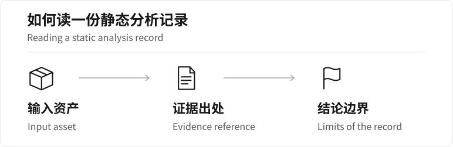

# re-skill

[简体中文](README.zh-CN.md) · [English](README.md)

A reverse-engineering reference library and a local static-analysis runner. Its records connect an input asset to the observations and limitations a reviewer needs to assess it.

Browse the [library index](docs/INDEX.md) or the [input examples](examples/README.md). The runner requires Python 3.11 or later. A static observation alone does not establish what happened on a device.
