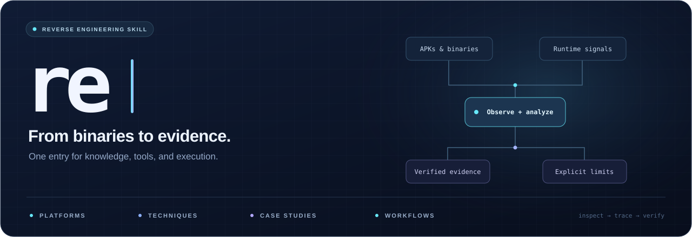
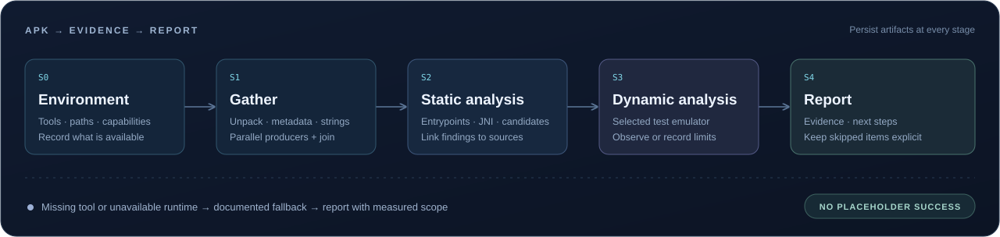

<p align="center">
  
</p>

<p align="center">
  <a href="SKILL.md"><strong>Open the skill</strong></a> ·
  <a href="#quick-start">Quick start</a> ·
  <a href="usage-scenarios.md">Find your scenario</a> ·
  <a href="techniques/INDEX.md">Explore techniques</a>
</p>

# re — Reverse Engineering Knowledge and Automation

A task-routed skill and asset-analysis runner that connect platform knowledge, runtime techniques, and concrete cases with executable research workflows. Start from an APK, binary, algorithm, or runtime obstacle; follow the relevant route and leave a traceable record of what the evidence supports.

- **One entry, focused reading.** [SKILL.md](SKILL.md) selects the workflow; branch indexes lead to the articles needed for that task.
- **Knowledge connected to execution.** Move between hooking, unpacking, traffic capture, algorithm restoration, tracing, and root-cause analysis without rebuilding a toolchain from scattered notes.
- **Explicit evidence and fallbacks.** APK stages record PASS or documented DEGRADED outcomes. Missing tools, incomplete recovery, and unverified hypotheses remain visible in the report.

## Choose a Starting Point

| What you have or need | Start here |
|---|---|
| Assets to inspect through the CLI, with reports and resumable state | [Runner guide and capability matrix](docs/runner.md) |
| APK static information and a full report | [Runner guide](docs/runner.md) |
| An explicit APK dynamic/full-chain request | [APK pipeline](pipeline/pipeline.md) |
| A hook, detection, encryption, or tracing problem | [Technique index](techniques/INDEX.md) |
| A platform-specific question or vulnerability root cause | [Platform index](platforms/INDEX.md) |
| A concrete case, historical technique, or protection lineage | [Case corpus](corpus/INDEX.md) · [coverage ledger](corpus/coverage-ledger.md) |
| A vulnerability hypothesis to investigate | [Research decision tables](breach-tables-cve.md) |
| A component version to compare against known CVEs | [CVE matching workflow](cve-hunter/README.md) |
| Publicly released firmware to inspect | [Firmware discovery workflow](fw-discover/README.md) |
| A missing tool or a new tool to evaluate | [Tool radar](radar/README.md) |
| A phone, microcontroller, or serial device | [Real-device procedure](device-testing.md) |

Not sure which route fits? [Usage scenarios](usage-scenarios.md) map common situations to their first useful article.

## Quick Start

### Browse or use the agent skill

Use this repository as the `re` skill folder in your agent's supported skill location, then start with [SKILL.md](SKILL.md). The entry and its relative references stay together; individual articles can also be read directly.

From the repository root, check the library and available environment:

```bash
# Check local routes, index coverage, and source syntax.
python3 scripts/validate_library.py

# Check available tools and report missing capabilities.
python3 pipeline/env_check.py
```

These checks do not install packages. The environment checker may probe adb/MCP and build a temporary smoke sample; defer it when execution or device checks are outside the requested task. On a new machine, follow [setup.md](setup.md) to prepare the dependencies you need. The repository does **not** include the local `tools-env/` binaries/venv, raw `data/` corpus, or machine snapshots.

Then give the agent a concrete task, for example:

```text
Run the full pipeline on /absolute/path/client.apk and return the report.

My Frida hook is detected. Find an equivalent observation point
and record the evidence for the route that works.

Restore this .so's signing algorithm and document what remains unverified.
```

For an autonomous run, use the task brief in [unattended.md](unattended.md). Its existing execution and submission boundaries still apply.

### Run the asset-analysis CLI

The repository also includes `re-run`, a bounded runner for mobile packages,
native binaries, firmware, source, containers, traffic, and other supported asset
profiles. It records evidence, coverage, logs, state, and JSON/Markdown reports;
analysis depth depends on the profile and available engines.

Use **Python 3.11+** and `uv` for the runner. From a working checkout:

```bash
uv sync --locked --all-extras --group dev
uv run --no-sync re-run inspect --asset /absolute/path/sample.apk
uv run --no-sync re-run doctor --profile android
uv run --no-sync re-run analyze --asset /absolute/path/sample.apk --output re-runs --language en
```

Use `re-run doctor --help` or the [runner guide](docs/runner.md) for other supported profiles. Local input analysis does not authorize following discovered network
endpoints. Network/device reads use the runner's explicit scope mechanism.
See the [input examples](examples/README.md), [delivery status](docs/delivery-status.md),
and [completion/acceptance guide](docs/agent-completion-prompt.md) for
profile limits and work requiring deeper verification. The runner does not
claim a reproduced vulnerability from a heuristic or a successful exit alone.

## APK to Report

<p align="center">
  
</p>

For an explicit APK S0–S4 or dynamic request, the [pipeline](pipeline/README.md) defines commands, artifacts, acceptance gates, and fallback paths for each stage. Static information/report requests can use the runner without starting an emulator. A bare URL must first be resolved as a Web asset or package download. Independent information gathering runs in parallel before dependent analysis joins; dynamic work uses the selected test emulator. Unavailable capabilities become explicit degradation entries rather than invented results.

The result is `输出/<package>-<date>/03-report.md`, alongside the supporting logs and artifacts. Continue from the report into the relevant technique or case article when deeper work is needed.

## Knowledge and Workflows

| Area | Role |
|---|---|
| [platforms/](platforms/INDEX.md) | Platform and domain knowledge: desktop/mobile systems, binaries, IoT, business, AI, blockchain, and root causes |
| [techniques/](techniques/INDEX.md) | Hooking, unpacking, evasion, algorithms, tracing, kernel observation, and tool selection |
| [corpus/](corpus/INDEX.md) | Distilled cases and historical methods, with completed and pending coverage recorded separately |
| `breach-tables/` | Recognition signals, validation actions, confirmation criteria, and false-positive exclusions, routed by the research entry |
| `src/re_runner/` · [examples/](examples/README.md) | Bounded asset-analysis CLI, input contracts, reports, resume/cancel, and engine adapters |
| [pipeline/](pipeline/README.md) | APK analysis orchestration and report artifacts |
| [cve-hunter/](cve-hunter/README.md) · [fw-discover/](fw-discover/README.md) | Known-CVE matching and public-firmware candidate triage |
| [radar/](radar/README.md) | Tool discovery, baseline maintenance, and local smoke-test records |
| Local `data/` · `tools-env/` | Original corpus, generated research state, installed tools, and the Python environment; kept outside Git |

Each branch INDEX owns its file list. This page is the overview, not a second catalog.

## Working Conventions

- Use [alternative approaches](racing.md) when a route fails and [test-value conventions](test-values.md) to keep probes and cleanup traceable.
- Keep version matches and firmware rule hits as **candidates** until their evidence gates pass. [Disclosure preparation](disclosure-cve.md) covers the path from a finding to a prepared submission.
- Treat dated tool observations and offline mocks as their stated evidence, not current availability or physical-device validation. The Stalker device adapter has offline coverage; target-specific compatibility still needs measurement.
- Tool radar runs at daily 09:00 only when a host schedule is configured. Copying the folder does not install that schedule.
- See [maintenance.md](maintenance.md) for update discipline and repeatable validation.

Built for authorized security research and technical learning. Scope is described in [DISCLAIMER.md](DISCLAIMER.md). Licensed under [MIT](LICENSE).
