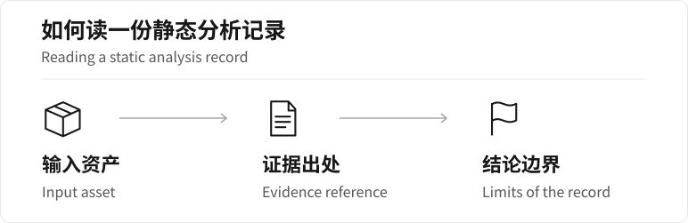

# re-skill

[简体中文](README.zh-CN.md) · [English](README.md)

逆向工程资料库与本地静态分析工具。它把输入资产、证据出处和分析限制放进同一份记录，方便工程师复核。

阅读从[资料索引](docs/INDEX.md)或[输入示例](examples/README.md)开始。运行器要求 Python 3.11 或更新版本。没有设备实测时，将结果保留为静态观察。
