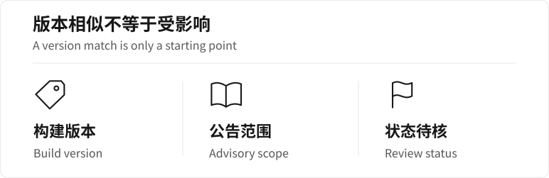

# OpenWrt version records

This directory describes candidate records based on published package versions. Use them when reviewing whether a vendor advisory applies to a particular build.

A version or banner match is a lead. Distribution patches, backports and configuration can change the answer; record the advisory and build evidence before assigning an affected status. [Project overview](../README.md).
