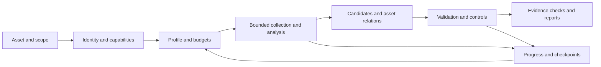

# From Asset Input to Reviewable Results: Baseline Gaps and Completion Plan

**Historical planning record, assessed 2026-10-19.** Its baseline was public checkout `0059a9a`,
branch fixes, and local inspection, with the user's selected scope of **all asset categories**.
The unified CLI and 12 basic profiles were subsequently added; statements below about absent
execution/locking/dependency infrastructure describe the original baseline, not current code.
Use [the runner matrix](runner.md), [delivery history](delivery-status.md), and
[completion handoff](agent-completion-prompt.md) for subsequent context. This is an engineering
estimate, not an empirical automation score; the original final edits had not been retested.

## Goal and Acceptance Levels

The principal missing layers were shared execution, tool adaptation, evidence, validation, and
acceptance. Existing knowledge and the APK DAG were reusable; more articles alone could not
productize arbitrary asset input → execution → reviewable conclusions.

| Level | Result | Acceptance criterion |
|---|---|---|
| L0: basic analysis | Type, structure, components/entry points, execution record, evidence, limitations | Required profile analysis actually completes and the report traces to artifacts |
| L1: candidate triage | Suspicious paths/components, priority, prerequisites, next steps | Each candidate has evidence and a detection rule; coverage gaps remain separate |
| L2: verification | Reproduced issue, trigger, impact, remediation | Validator succeeds with replayable evidence and a negative control |

Every valid request should yield a report, including failures/missing prerequisites; a report
alone does not satisfy L0 acceptance. Missing device/account/tool conditions require degraded
or blocked status, not a supported-profile claim. A negative result means “none found in the
completed checks,” with coverage disclosed. No universal schedule can promise CVE assignment,
0day discovery, or deobfuscation of arbitrary programs; novelty and disclosure follow verification.

## Original Asset Gaps

This table describes baseline executable coverage, not article volume.

| Asset | Reusable baseline | Missing steps | First L0/L1 evidence |
|---|---|---|---|
| URL/domain/IP/service | Web, business, attack-surface references | Scope, service inventory, bounded collection, page/endpoint structure, sessions, network budgets | Target/service inventory, scope, HTTP evidence, coverage |
| API/OpenAPI/GraphQL/WebSocket/gRPC | Web/API references; some methods in other skills | Specification parsing, roles, object relations, capture/replay, method capability checks | Endpoint/method inventory, anonymous/authenticated state, requests/responses, candidate boundaries |
| APK/AAB/Android device | Documented S0–S4 DAG and environment helpers | Runnable runner, AAB conversion, Manifest/DEX/native parsing, device branch, log validation | Package/components/permissions/DEX/SO, conditional dynamic evidence, report |
| IPA/Apple bundle | iOS/macOS methods/tools | Container, Mach-O/signature/entitlements, encryption, device/simulator adapters | Bundle/entitlements, analyzable/encrypted ranges, evidence |
| PE/ELF/Mach-O/.NET/JVM/Go/Rust/WASM | Platform/tool articles | Type/architecture, symbols/dependencies/entry, provider session, obfuscation degradation, isolation | Metadata, segments/sections/imports/exports, selected functions/references, limits |
| Firmware/filesystem/configuration | DD-WRT/OpenWrt seed scripts and rule ledger | Arbitrary local input, multi-format extraction, original retention, components, bounded emulation/verification | Original hash, extraction inventory, components/candidates/review state |
| Source/Git repository | Code-audit/root-cause references | Language/framework/entry/dependencies, tool normalization, reachability | Project/component inventory, source locations, call/data-flow evidence |
| Container/SBOM/dependencies | Component-version matching | OCI/layers/SBOM intake, normalization, advisories/patches, offline cache | Component/layer location, version candidates, backport/config unknowns |
| PCAP/HAR/saved traffic | Network/protocol restoration references | Parsers, flow index, redaction, protocol/session normalization | Flows/protocols/endpoints, traceable records, redacted summary |
| IoT/MCU/serial/wireless | Device procedure and hardware articles | Identity/capability/allowed operations, collectors, firmware relation, fixtures | Device/interfaces, collection evidence, conditions/gaps |
| AI service/agent/model | AI-security references | Separate service/config/weights; behavioral test set, tool-permission graph, data flow/controls | Permissions/trust boundaries, configuration/behavior evidence, parseable weight-format registration |
| Contract/deployment/EVM | Blockchain and AI crossover references | Source-bytecode relation, proxy/permissions, chain/address scope, testnet/fork reproduction | Contract/permission graph, code evidence, deployment conditions, verification |

“All types” must mean explicit format, protocol, environment, and operation lists. Binary
support needs architecture/format/static/dynamic detail; hardware support needs capabilities,
not brand names. Publish accepted capabilities separately from intake-only integrations.

### Baseline Defects and Machine Conditions

The branch had fixed skill frontmatter, firmware `--status`, gzip original-sample mutation,
and CVE package download paths. Atomic locking, retry semantics, download/unpack budgets,
fixed proxy, NVD novelty inference, platform commands, and local-artifact dependencies remained
for follow-up; see [project review](project-review.md). The local environment check returned
`2`: APK essentials, SDK/AVD, and the repository venv were missing. Machine prerequisites and
missing execution code are distinct gaps.

## Complete Workflow and Shared Models

| Module | Required behavior | Testable delivery |
|---|---|---|
| Intake/scope | Shared model for files/directories, URLs, devices, specifications, chain addresses; retain provenance/authority boundaries | AssetRequest, detection, explicit unknown-type reasons |
| Capabilities | Profile tools/versions/devices/accounts/sessions/backends | capabilities.json and explained degradation |
| Deterministic scheduling | DAG, timeout, bounded retry, cancel, budgets, persistence/resume | Valid successful expensive/side-effect stages are not repeated |
| Adapters | Normalize CLI/MCP/engine outputs; argument lists; stdout/stderr/exit status | ToolRun and integration tests |
| Evidence/relations | Hash, location, time, version, originals; embedded/dependent/exposed assets | Evidence index, reference checks, child provenance |
| Detection | Structure/version/config/call/data-flow rules with false-positive conditions | Candidate, rule_id, evidence references, coverage |
| Validation | Local controls, sandbox/emulator/testnet/scoped network as appropriate | Upgrade findings only after actual success; unknown remains unknown |
| Reporting | Five-part research output, coverage/skips/budgets/failures/limits | JSON/Markdown match execution records |
| Evaluation/release | Fixed samples/oracles/errors/OS matrix, dependency lock, CLI | Repeatable integration and truthful support matrix |

Prefer a deterministic Python core and stable CLI/schema. LLMs select routes, interpret semantics,
and draft reports; adopt CrewAI/other orchestration only if it materially simplifies state and
collaboration. Hashing, extraction, retries, and state updates should not depend on improvised
agent judgment.

- `Asset`: ID, type, hash/locator, format/architecture, provenance, parent, scope.
- `ToolRun`: tool/version/arguments, start/end, exit, timeout, artifacts.
- `Evidence`: ID, source asset/tool run, file/request location, hash, redaction.
- `Finding`: observation/candidate/verified/excluded, rule/validator, evidence, trigger, impact, fix.
- `RunState`: stages, completed tasks, budgets/retries/dependencies, terminal state.

NVD/CVE results are candidate context, not automatic verification. Record provenance for new
domains, third-party APIs, accounts, devices, and deployments; embedding does not confer scope.

## Milestones and Effort Estimate

Assumptions: one Python/security-tool maintainer with agent assistance, mature tools reused,
CLI first, required environments available, no new decompiler or vulnerability-model training.
Person-days exclude procurement, accounts/vendor access, large-sample waiting, external approval.

| Milestone | Work | Estimate | Gate |
|---|---|---|---|
| M0: shared core | Baseline fixes, input/scope/schema/CLI/adapters/state/evidence/budgets/reports | 4–7 person-days | Local fixtures analyze; reports/logs agree; failure/resume tests pass |
| M1: main software | URL/API, APK, native binary, arbitrary local firmware | 10–18 | One real complete path per group; missing conditions explicit |
| M2: all categories | IPA/source/OCI/SBOM/traffic/hardware/AI/chain; AAB/protocol/architecture matrix | 15–30 | One specific capability per category passes a real fixture; detailed gaps public |
| M3: reliable delivery | High-value validators/controls, concurrency/resume, OS CI, false-positive evaluation, release | 10–20 | Published benchmark accepts required capabilities and risk checks |

Total for that bounded matrix: **39–75 person-days, about 8–15 work weeks for one person**.
M0+M1 could yield the first runnable main-asset version in **3–5 weeks**. Familiarity,
compatibility, and verification difficulty change the range. It does not promise arbitrary
vulnerability confirmation within that time; expand L2 per vulnerability family/environment.

For every profile, predefine expected output and exercise: (1) valid normal input, (2) known
risk/suspicious fixture whose rule fires and whose confirmation requires validation, (3) malformed/
unsupported input with truthful failure, (4) missing tool/device/account, (5) timeout/process
failure with enforced budgets, and (6) interruption/resume with integrity checks, no repetition
of valid stages, and no duplicate findings. Parsing profiles may use definite structural/config
oracles instead of invented vulnerabilities. Core CI is offline; integrations use local lab
services, emulators/sandboxes/testnets. Remote probes follow scope and budgets.

| Backend candidate | Scenario | Verify before integration |
|---|---|---|
| REA | Multi-format/multi-engine | Current release tools, provider capabilities, output contract |
| MobSF/JADX/Apktool | APK reports | Version/API/device/license |
| IDA Pro MCP/GhidraMCP/ReVa/radare2 | Native databases/functions | License/session/mutation authority/headless/host compatibility |
| Rust RE Skill | Rust-specific work | Artifact locations/dependencies/formats/license |
| Existing connectors/CLIs/domain skills | Web/API/other domains | Scope/auth/tool schema/budgets |

These were candidate integrations, not completed shared backends at the planning baseline.

## Failure Prevention and Follow-up

Prevent unrun steps reported as success, version/string candidates reported as vulnerabilities,
swallowed tool errors, implicit scope expansion, and unreviewable samples/state/evidence.
Use original retention/content hashes, atomic state, budgets/reference checks, negative controls,
resume, and real fixtures. Lead reports with useful completed findings and visible gaps; even
negative results require execution evidence. Deliver real basic profiles across all categories,
then expand high-value detection/validation with benchmarks and matrix updates. Continue through
[the implementation handoff](agent-completion-prompt.md).
