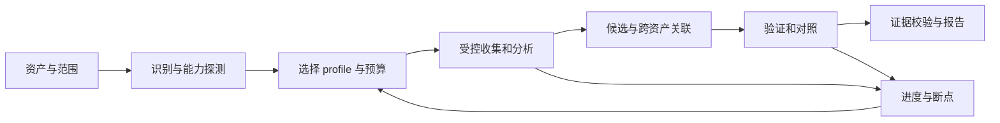

# 从资产输入到可复核结果：全资产差距与补全路线

> **本页保留最初基线差距与工期估算。**当前分支已新增统一 CLI 和 12 类基础
> profile，下文“无执行器/无锁/无依赖锁”等描述不再代表现状。
> 最新能力见[交付状态](delivery-status.zh-CN.md)、[全资产矩阵](runner.zh-CN.md)。
> 剩余工作以[安装、补全与验收 Prompt](agent-completion-prompt.zh-CN.md)为准，最后修改未复验。

评估日期：2026-10-19。范围依据用户选择：**所有资产类型**。
当前状态来自公开仓库 `0059a9a`、本分支修复及本机检查。
这是工程规划估算，不是自动化能力的实测评分。

## 1. 目标与问题概览

**距离目标主要差统一执行层、工具适配层、证据层、验证层和验收体系。**
现有知识和 APK DAG 可以复用，但“任意资产输入 → 自动执行 → 可复核结论”尚未
产品化。继续增加文章不能替代这些工程模块。

先把“结果”拆成三种可验收能力：

| 层级 | 用户拿到的结果 | 完成标准 |
| --- | --- | --- |
| L0：基础分析 | 资产类型、基本结构、组件/入口、执行记录、证据与限制 | 实际完成该 profile 的必需分析；报告可追溯到产物 |
| L1：候选筛选 | 可疑路径、受影响组件、优先级、前提与下一步 | 每条候选有证据和检测规则；覆盖缺口独立显示 |
| L2：验证确认 | 已复现的安全问题、触发条件、影响、修复建议 | 验证器执行成功，存在可重放证据和负向对照 |

每次有效请求都应产生报告，包括失败和缺条件报告；**生成了报告本身不代表 L0
支持验收通过**。缺设备、账号、工具时只能标记 `degraded/blocked`，不能把该
profile 标为已支持。未发现问题的结果应表述为“在已完成检查中未发现”，并列出覆盖。

自动确定 CVE、保证 0day、保证任意程序反混淆成功，没有通用可承诺的时间表。
漏洞确认之后的新颖性判断和披露也要单独处理。

## 2. 技术差距：当前资产入口与缺失链路

以下状态描述公开 checkout 的可执行程度，不描述知识文章的多少。

| 资产类型 | 当前基础 | 缺少的关键步骤 | 首次 L0/L1 验收产物 |
| --- | --- | --- | --- |
| URL / 域名 / IP / 服务 | Web、业务与攻击面参考 | Scope、服务清点、受控收集、页面/端点结构、会话、网络预算 | 目标与服务清单、允许范围、HTTP 证据、覆盖表 |
| API / OpenAPI / GraphQL / WebSocket / gRPC | Web/API 参考，部分方法依赖其他技能 | 规范解析、认证角色、对象关系、请求录制/回放、方法能力检查 | 端点与方法清单、匿名/授权状态、请求响应证据、候选边界 |
| APK / AAB / Android 设备 | S0–S4 文档 DAG；环境辅助脚本 | 可运行 runner、AAB 转换、Manifest/DEX/Native 结构解析、设备分支、日志校验 | 包结构、组件、权限、DEX/SO、可选动态证据、报告 |
| IPA / Apple App bundle | iOS/macOS 方法与工具参考 | 容器解析、Mach-O/签名/Entitlements、加密状态、设备或模拟器适配 | Bundle 清单、Entitlements、可分析与加密范围、证据 |
| PE / ELF / Mach-O / .NET / JVM / Go / Rust / WASM | 平台与工具文章 | 类型与架构识别、符号/依赖/入口、provider 会话、混淆降级、动态隔离 | 元数据、段/节/导入导出、选定函数与引用、分析限制 |
| 固件 / 文件系统镜像 / 配置 | DD-WRT/OpenWrt 种子脚本、规则台账 | 任意本地文件入口、多格式提取、样本保留、组件识别、受限模拟/验证 | 原始 hash、提取清单、组件、候选、复核状态 |
| 源码目录 / Git 仓库 | Code audit 与根因参考 | 语言/框架、入口/依赖、源码分析工具、规则结果归一、可达性验证 | 项目与组件清单、源码位置、调用/数据流证据 |
| 容器镜像 / SBOM / 依赖清单 | 组件版本匹配可复用 | OCI/镜像层与 SBOM 输入、组件归一、公告/补丁上下文、离线缓存 | 组件与层定位、版本候选、回移/配置未知项 |
| PCAP / HAR / 保存的流量 | 网络与协议还原资料 | 解析器、流索引、敏感信息遮蔽、协议/会话归一 | 流与协议清单、端点、可追溯记录、脱敏摘要 |
| IoT / MCU / 串口 / 无线设备 | `device-testing.md` 与硬件文章 | 身份与设备能力探测、允许操作、采集器、固件关联、测试夹具 | 设备身份与可用接口、采集证据、设备条件和缺口 |
| AI 服务 / Agent 配置 / 模型资产 | `platforms/09-ai-security/` 参考 | 区分服务/配置/模型权重、行为测试集、工具权限图、数据流与对照验证 | 工具权限/信任边界、配置或行为证据；权重按可解析格式登记 |
| 智能合约 / 链上部署 / EVM 字节码 | 区块链安全与 AI 交叉参考 | 源码/字节码关联、代理/权限结构、链 ID 与地址 Scope、测试网或 fork 复现 | 合约与权限图、代码证据、部署条件、验证结果 |

“所有类型”要落实为**明确的格式、协议、运行环境和操作能力清单**。
例如“支持二进制”还需要声明架构、格式、静态/动态能力；“支持硬件”不能只列几个
品牌。新格式可以继续扩展，当前交付应公开哪些通过验收、哪些只完成接入。

### 已确认的基础缺陷

本分支已修复技能 frontmatter、固件 `--status`、gzip 原始样本改写、CVE 包下载路径。
仍需处理原子锁、失败重试语义、下载/解包预算、固定代理、NVD 新颖性误判、
跨平台命令与本地产物依赖。详见[项目评估](project-review.zh-CN.md)。

本机环境检查返回 `2`，缺少 APK 关键工具、SDK/AVD 和仓库本地虚拟环境。
这属于当前机器环境缺口；统一执行器不存在则属于代码缺口，两者不能混为一项。

## 3. 应补全的完整工作链

| 模块 | 要实现的行为 | 可测试的交付 |
| --- | --- | --- |
| Intake 与 Scope | 本地文件/目录、URL、设备、规范、链地址进入共享模型；保留来源和权限边界 | AssetRequest、类型检测、明确无法识别的原因 |
| 环境与能力注册 | 按 profile 检查工具、版本、设备、账号/会话与可用后端 | capabilities.json；缺某能力时可解释降级 |
| 确定性调度 | 阶段 DAG、超时、有限重试、取消、预算、持久化与恢复 | 同一任务恢复时不重复成功的昂贵/有副作用步骤 |
| 工具适配 | 把现有 CLI/MCP/引擎输出归一；命令参数化、保存 stdout/stderr 与退出状态 | ToolRun 及 adapter 集成测试 |
| 证据与资产关系 | 记录 hash、位置、时间、工具版本与原始证据；关联嵌入/依赖/暴露资产 | Evidence 索引、引用校验、子资产来源 |
| 候选检测 | 结构、版本、配置、调用点和数据流规则；明确误报条件 | Candidate 与 rule_id、证据引用、覆盖记录 |
| 验证 | 按风险选本地对照、沙箱、模拟器、测试网或受控网络验证 | Finding 只在验证实际成功后升级；未知不当成功 |
| 报告与质量门 | 输出五项研究结构，列出覆盖、跳过、预算、失败和限制 | JSON + Markdown，与真实执行记录一致 |
| 评测与发布 | 固定样例、oracle、错误场景、OS 矩阵、依赖锁与命令入口 | 可重复集成结果及真实的能力矩阵 |

推荐以 Python 的确定性工作流为核心，CLI 和 schema 先稳定；LLM 用于路线选择、
语义解释和报告草稿。只有框架能实质简化状态与协作时才引入 CrewAI/其他编排框架。
不需要让每一次 hash、解包、重试和状态更新都依赖 Agent 临场判断。

### 共享数据约定

- `Asset`：ID、种类、hash/定位、格式/架构、来源、父资产、Scope。
- `ToolRun`：工具/version、参数、开始结束、退出状态、超时与产物。
- `Evidence`：ID、源资产、工具运行、文件或请求定位、hash、脱敏信息。
- `Finding`：观察/候选/已验证/被排除、规则与验证方法、证据、触发条件、影响、修复。
- `RunState`：阶段状态、已完成任务、预算、重试次数、依赖、最终状态。

NVD/CVE 检索结果是候选上下文，不自动把 `Candidate` 升为 `Verified`。
新的域名、第三方 API、账号、设备与链部署要记录来源，不能从嵌入关系推导新的测试授权。

## 4. 验证步骤、里程碑与工期

估算前提：一名熟悉 Python/安全工具的维护者，有 Agent 辅助；复用成熟工具，
先交付 CLI；能取得所需测试环境；不自研反编译器或训练漏洞模型。
人日为投入工作量，未计硬件采购、账号申请、厂商权限、超大样本等待和外部审批。

| 阶段 | 工作内容 | 工程初估 | 完成门槛 |
| --- | --- | --- | --- |
| M0：共用执行底座 | 修基础缺陷、输入/Scope/schema、CLI、adapter 合同、状态/证据/预算/报告 | 4–7 人日 | 本地 fixture 能实际分析、报告与日志对得上，失败/恢复测试通过 |
| M1：主要软件资产 | URL/API、APK、原生二进制、任意本地固件四组 profile | 10–18 人日 | 每组至少一条真实完整路径；不足条件明确输出限制 |
| M2：扩展全部类别 | IPA、源码、OCI/SBOM、流量、硬件、AI、链上，补 AAB/协议/架构矩阵 | 15–30 人日 | 每类至少一个明确能力通过真实 fixture；细分缺口公开 |
| M3：可靠交付与验证覆盖 | 高价值验证器、对照样例、并发/恢复、OS CI、误报评测、安装发布 | 10–20 人日 | 必需能力与风险验证按公开基准验收 |

按上述有限支持矩阵，合计约 **39–75 人日，单人约 8–15 个工作周**；M0+M1 约
**3–5 周**可形成主要资产的首个可运行版本。熟悉度、工具兼容和验证难度会改变范围。
这不等于在该工期内完成任何资产的任意漏洞确认；L2 按具体漏洞族和环境逐步扩大。

### 每类 profile 的验收清单

至少包含以下真实情境，预期输出在运行前定义：

1. 合法正常样例：类型、必需分析、产物、证据引用正确。
2. 带明确风险或可疑特征的实验样例：命中预设规则；只有验证成功才确认。
3. 格式损坏/不支持：明确错误，仍有失败报告，不生成虚构结构。
4. 缺工具/设备/账号：明确缺口，不冒充完整覆盖。
5. 超时/进程失败：预算和进程控制生效，状态可追踪。
6. 中断后恢复：校验产物完整性，成功阶段不重复，无重复 findings。

纯解析类 profile 不需要虚构一个漏洞，可以使用确定的可疑配置或结构特征作 oracle。
核心 CI 离线执行；集成测试对本机实验服务、模拟器/沙箱/测试网运行。
任何远程探测都由实际 Scope 与预算约束。

### 优先复用的后端

| 场景 | 后端候选 | 集成前核验 |
| --- | --- | --- |
| 多格式/多引擎逆向 | REA | 所需工具是否存在于当前 release、provider 能力与输出合同 |
| APK 基础报告 | MobSF、JADX、Apktool | 服务/工具版本、接口、设备条件、license |
| 原生数据库与函数分析 | IDA Pro MCP、GhidraMCP、ReVa、radare2 | 引擎许可、会话、修改权限、headless 与主机兼容 |
| 专项 Rust | Rust RE Skill 的方法和脚本 | 产物定位、依赖、适用二进制格式与许可 |
| Web/API 与其他领域 | 现有连接器/CLI、对应安全技能 | Scope、认证状态、实际工具 schema、执行预算 |

这些是适配候选，当前仓库并未完成统一集成。

## 5. 影响、修复与运行检测

要防止的错误是：把未运行的步骤写成成功、把版本/字符串候选写成漏洞、把工具错误
吞掉、把分析过的一个资产自动扩成外部测试范围，以及样本/状态/证据无法复核。

使用内容 hash 与原始样本保留、原子状态更新、工具预算、引用校验、负向对照、
断点恢复和真实 fixture 来约束这些错误。报告应突出最有价值的已完成结论，并让
用户直接看到覆盖和未完成项。没有发现也要有运行证据。

先交付所有类别的真实基础 profile，再逐项增加高价值候选与验证器；每次扩大支持
都增加基准和能力矩阵。下一 Agent 的完整要求见
[补全 Prompt](agent-completion-prompt.zh-CN.md)。
