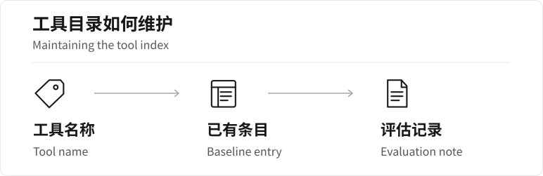

# Reverse-engineering tool index

The [baseline list](baseline-tools.md) records tool names that are already known to the project. Check it before adding an entry so renamed or repeated mentions do not inflate the list.

In a new note, distinguish a tool that was merely listed from one evaluated on a named platform and version. [Back to the library](../README.md).
